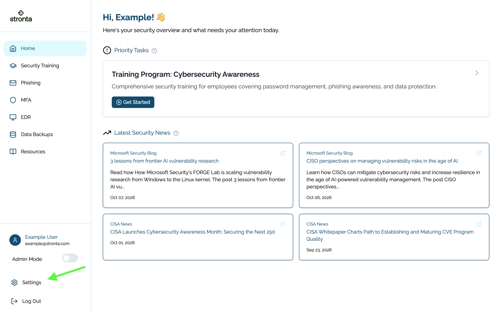
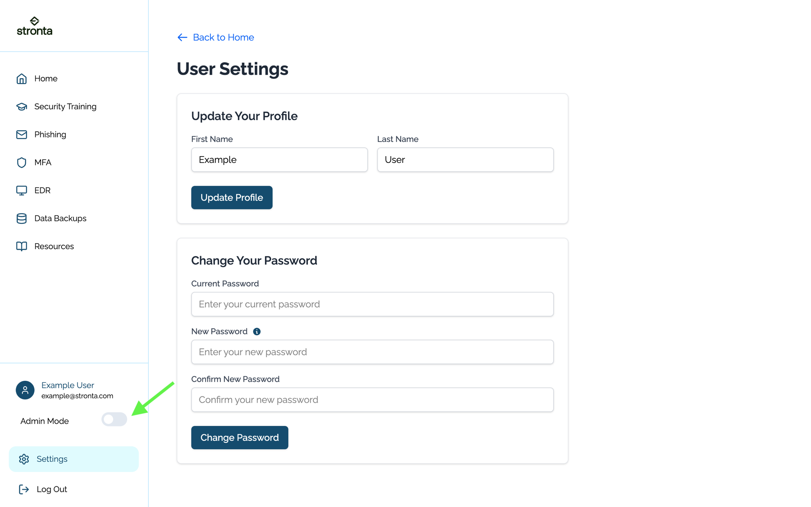
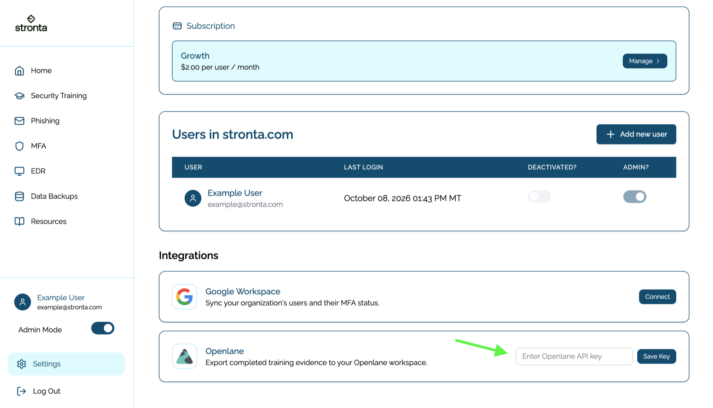
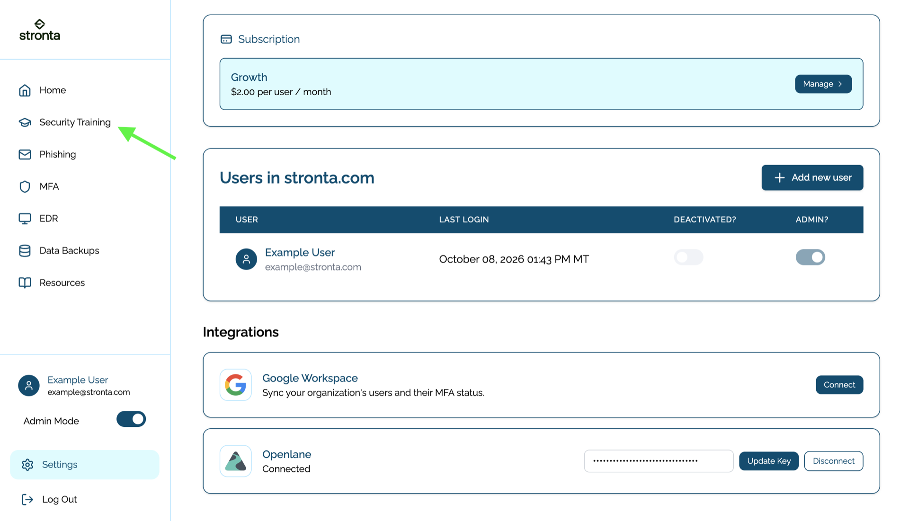
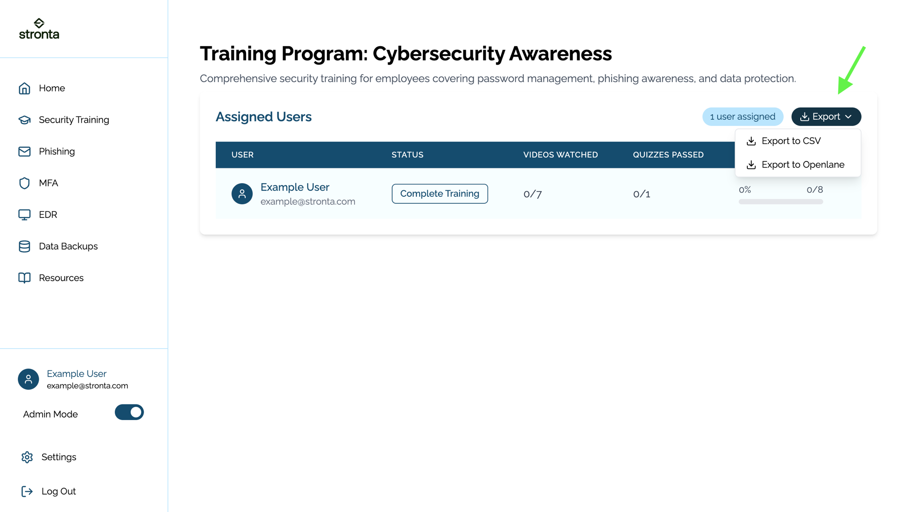
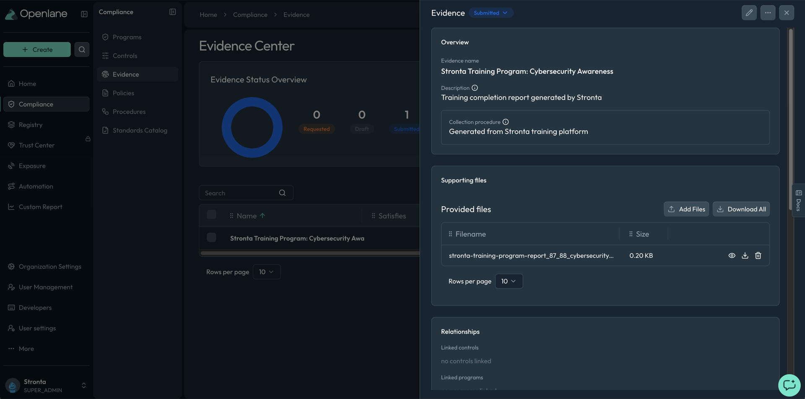

import Steps from '@site/src/components/Steps';
import Term from '@site/src/components/Term';

#  Stronta integration guide

If your organization runs security awareness training through Stronta, this integration exports
training completion to Openlane as <Term t="evidence">evidence</Term>. Each export creates an
evidence record with the completion report attached, so training proof is ready for the
<Term t="controls">controls</Term> it supports.

## Capabilities

Stronta exports a training completion report to Openlane and creates an evidence record with the
report attached, all in one action. You can also download the report as a CSV and upload it as evidence
yourself.

Reports are scoped to a single training program, such as Cybersecurity Awareness, so each evidence
record maps to the training it demonstrates. The connection uses an Openlane API token limited to
evidence writes rather than a personal credential.

## Prerequisites

* A Stronta workspace with the Security Training module enabled.
* Administrative access in Stronta to enable **Admin Mode** and save the Openlane API token.
* An API token that includes the `evidence:write` scope. Creating an API token requires admin access and a payment method on file for your Openlane organization. See
  [Programmatic Authentication](../settings/authentication/programmatic.mdx).

## Step-by-step setup

### Step 1: Create an API token

<Steps>

1. Go to **Developers** > **API Tokens**.
1. Click **Create** and name the token, for example `Stronta`.
1. Set an **Expiration** and grant the `evidence:write` scope.
1. Click **Create Token** and copy the value, which is shown only once.

</Steps>

:::warning
Create a dedicated token for this integration and grant only the scopes it needs. A token with
`evidence:write` can create evidence in your organization.
:::

### Step 2: Connect Stronta to Openlane

<Steps>

1. Log in to [app.stronta.com](https://app.stronta.com/) as an admin.

1. Click **Settings** in the left navigation.

   

1. Enable **Admin Mode** with the slider in the left navigation. Admin Mode reveals the
   organization and integration settings.

   

1. Find the **Openlane** integration, enter your API token in **Enter Openlane API key**, and click
   **Save Key**.

   

1. Confirm the integration shows **Connected**.

</Steps>

### Step 3: Export training evidence

<Steps>

1. Click **Security Training** in the left navigation and open the training program you want to
   report on.

   
1. Click **Export** and choose an option.

   | Export option | Result |
   | --- | --- |
   | **Export to Openlane** | Creates an evidence record in Openlane with the completion report attached |
   | **Export to CSV** | Downloads the completion report so that you can upload it as evidence yourself |

   

1. If you exported to CSV, upload the file via the
   [Evidence Center](../compliance-management/evidence/create.mdx).

</Steps>

## Validate connection

Saving the API token connects the integration immediately, and the Openlane integration card shows
**Connected** with controls to **Update Key** or **Disconnect**. To confirm the connection end to
end, run **Export to Openlane** from a training program and check for the new record in Openlane.

## What Openlane receives

Each export creates one evidence record in Openlane. The record is named after the training program,
for example **Stronta Training Program: Cybersecurity Awareness**, and the completion report is
attached as a CSV file with one row per assigned user:

```text
Full Name,Email Address,Videos Watched,Video Percentage Complete,Quizzes Passed,Quizzes Percentage Complete,Overall Tasks Completed,Overall Completion Percentage
Example User,example@stronta.com,7,100%,1,100%,8,100%
```



Link the record to the controls it supports. Exports do not link controls automatically, and
unlinked evidence will not be seen by an auditor during a review.

## Disconnect

To remove this integration:

<Steps>

1. In Stronta, open **Settings**, find the **Openlane** integration, and click **Disconnect**.
1. In Openlane, revoke the API token under **Developers** > **API Tokens**.

</Steps>

Disconnecting stops new exports. Evidence records already created in Openlane remain, and you can
reconnect by saving a new token.

## Troubleshooting

- **No evidence created**: If an export fails, confirm that the Openlane token has not expired or been revoked, and that the token includes the`evidence:write` scope. Then, use the **Update Key** button on the integration card within Stronta to resubmit the key, to ensure that the correct value has been provided.
- **Control reference missing**: If an evidence record is missing its controls, you must create links manually; the integration does not yet automatically link exported evidence to controls.

## References

* [Stronta](https://app.stronta.com/)
* [Programmatic Authentication](../settings/authentication/programmatic.mdx)
* [Create Evidence](../compliance-management/evidence/create.mdx)
