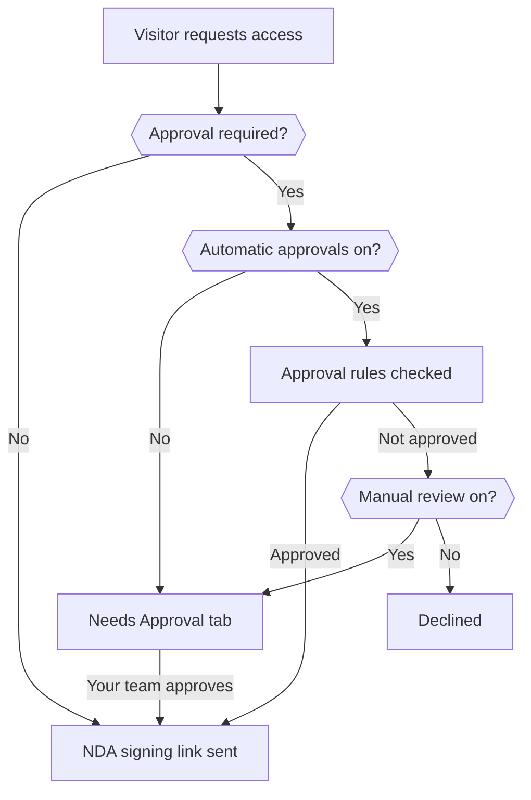
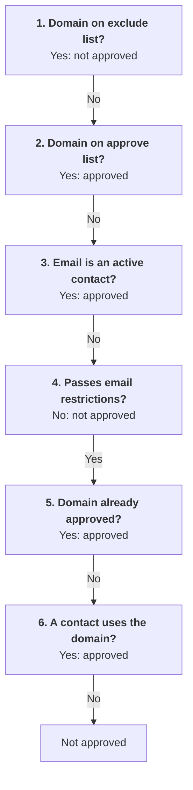

# NDAs

Upload your non-disclosure agreement (NDA) template that visitors must sign before accessing private documents. Without an NDA configured, visitors cannot access any documents marked as Private.

## How it works

What happens after a visitor asks for a private document depends on whether you require approval before signing:

1. The visitor requests access and enters their name, company, and email address.
1. If you require approval, the request waits until your team or your [automatic approval rules](#automatic-approval) approve it. Without required approval, this step is skipped.
1. Openlane emails the visitor a link to sign your NDA.
1. The visitor signs electronically, and Openlane emails them a link to your private documents.

## NDA content

Your NDA should include:

* Parties to the agreement
* Definition of confidential information
* Obligations of the receiving party
* Duration of confidentiality obligations
* Permitted uses and disclosures

Upload the NDA as a PDF. We will append a signing page with the signatory information for your records, so structure your agreement accordingly.

## Updating the NDA

When you upload a new NDA, it applies to future access requests. Visitors who already have approved access do not need to re-sign.

If visitors signed your NDA in another trust center, you can bring those records over with `Import Signed NDAs`. See [Migrating from another trust center](./migrating.mdx#signed-ndas).

## Require approval before signing

Turn on **Require approval before NDA signing** in **Access Rules** when you want to decide who receives your NDA. With it off, Openlane sends the NDA as soon as a visitor asks, and anyone who signs gets access.

With it on, each new request appears in the **Needs Approval** tab of the NDA requests table, where you can approve requests one at a time or with **Approve All**. Openlane notifies the group you choose under **Approval Notification Recipients**. If you do not choose a group, the organization's owners and admins are notified.

## Automatic approval

Automatic approval decides requests for you based on who is asking. Use it when most requests come from people you would approve anyway, such as contacts at existing customers, and you want your team to review only the rest. It is available once **Require approval before NDA signing** is on.

To turn it on:

1. Turn on **Enable automatic approvals**.
1. Review the rules. On first use, **Approve existing contacts**, **Approve previously approved domains**, **Require work email addresses**, and **Send unmatched requests to manual review** start on.
1. Select **Enable Automatic Approvals**.

You should see the callout under **Access Rules** change to "Automatic approval rules will be applied to incoming NDA requests." To change rules later, edit them and select **Save Rules**. A rule that takes a list of domains needs at least one domain before you can save it.

Requests approved by a rule show **Auto-approved** in the **Approved By** column, and you can filter the table by **Auto-approved**.

### Approval rules

A request is approved automatically when it matches any rule that is on.

| Setting | What it does |
|---|---|
| **Approve existing contacts** | Approves a request when the email address matches an active contact in your organization. |
| **Approve contact domains** | Approves a request when any active contact in your organization uses the same email domain. |
| **Approve previously approved domains** | Approves a request when another request from the same domain has already been approved or signed on this trust center. |
| **Approve specific domains** | Approves every request from a domain you list. |

### Email address restrictions

Restrictions never approve a request on their own. They stop **Approve previously approved domains** and **Approve contact domains** from approving an address that fails them. The two exact-match rules, **Approve specific domains** and **Approve existing contacts**, are checked before the restrictions (see [how the settings work together](#how-the-settings-work-together)).

| Setting | What it does |
|---|---|
| **Require work email addresses** | Addresses at free email providers (such as gmail.com) and disposable addresses cannot be approved by the contact domain or previously approved domain rules. |
| **Role email addresses can qualify** | When off, addresses such as `support@` or `sales@` cannot be approved by the contact domain or previously approved domain rules. When on, they qualify like any other address. |
| **Disposable email addresses can qualify** | When off, known disposable addresses cannot be approved by the contact domain or previously approved domain rules. Unavailable while **Require work email addresses** is on, because that setting already excludes disposable addresses. |
| **Exclude specific domains** | Requests from a domain you list are never approved automatically, even when the visitor is an existing contact or the domain is also on your **Approve specific domains** list. Use it for competitor domains. |

Openlane also does not approve an address it cannot verify, such as one with an invalid format.

### When no rule approves a request

**Send unmatched requests to manual review** decides what happens to everything the rules do not approve. With it on, the request goes to the **Needs Approval** tab and your approvers are notified, as if automatic approval were off. With it off, the request is declined and the visitor does not receive a link to sign your NDA.

We recommend keeping it on. With it off, a legitimate buyer using an address your rules do not recognize is declined before anyone on your team sees the request.

### How the settings work together

Two settings decide whether a request reaches the approval rules at all, and **Send unmatched requests to manual review** (shown as manual review) decides what happens when no rule approves it:

Openlane checks the rules in this order and stops at the first decisive result. A step for a setting that is off is skipped.

In order, those steps are **Exclude specific domains**, **Approve specific domains**, **Approve existing contacts**, the email address restrictions, **Approve previously approved domains**, and **Approve contact domains**. A request that ends at "Not approved" goes to manual review or is declined, depending on **Send unmatched requests to manual review**.

:::warning[Two rules run before the restrictions]
**Approve specific domains** and **Approve existing contacts** are checked before the email address restrictions. A contact who uses a personal address is approved even when work email addresses are required, and a listed domain approves its role addresses even when role addresses cannot qualify. Do not list a free email provider such as gmail.com under **Approve specific domains**, because that approves every address at that provider.
:::

### Scenarios

Each scenario starts from the settings automatic approval turns on by default (**Approve existing contacts**, **Approve previously approved domains**, **Require work email addresses**, and **Send unmatched requests to manual review**) unless it says otherwise.

An existing customer contact requests access

Jordan at `customer.example.com` is an active contact in your organization and requests access with that address.

**Approve existing contacts** matches the email address, so the request is approved and Jordan receives the NDA signing link without anyone on your team acting on it.

A colleague of an approved visitor requests access

Last month your team approved a request from `jordan@customer.example.com`. Today Sam requests access as `sam@customer.example.com` and is not a contact.

Sam is not a contact, and `customer.example.com` is a work domain, so the restrictions pass. **Approve previously approved domains** finds the earlier approval for the same domain and approves Sam's request.

If you turned **Approve previously approved domains** off and had no other matching rule, Sam's request would go to the **Needs Approval** tab instead.

A prospect requests access with a personal email address

A visitor requests access as `pat@gmail.com`. Pat is not a contact, and `gmail.com` is not on either domain list.

**Require work email addresses** excludes free email providers, so neither the contact domain rule nor the previously approved domain rule can approve the request. It goes to the **Needs Approval** tab, where your team can approve it after confirming who Pat is.

With **Send unmatched requests to manual review** off, the same request is declined and Pat does not receive the NDA.

A contact requests access with a personal email address

Your organization has an active contact whose email address is `riley@gmail.com`, and Riley requests access with that address.

**Approve existing contacts** is checked before the email address restrictions, so the request is approved even though **Require work email addresses** is on.

A shared sales inbox requests access

A request arrives from `sales@partner.example.com`. **Role email addresses can qualify** is off.

If `partner.example.com` is on your **Approve specific domains** list, the request is approved, because that list is checked before the restrictions. If the domain only matches through **Approve contact domains** or **Approve previously approved domains**, the role address restriction stops the match and the request goes to manual review.

Turn on **Role email addresses can qualify** if you want shared inboxes treated like any other address.

A competitor requests access

You list `competitor.example.com` under **Exclude specific domains**. Someone at that domain requests access, and they also happen to be an active contact from a past partnership.

**Exclude specific domains** is checked before every approval rule, so the request is never approved automatically. It goes to the **Needs Approval** tab if manual review is on, or is declined if it is off.

Approval is not required

**Require approval before NDA signing** is off. A visitor at any domain, including a competitor or a free email provider, requests access.

Openlane sends the NDA signing link right away. Automatic approval rules, domain lists, and email address restrictions do not run while approval is off, and anyone who signs gets access to your private documents.

## Best practices

* Use a mutual NDA to protect both parties
* Keep terms reasonable and industry-standard
* Review the language with legal counsel
* Use a format that signers will recognize
* Keep **Send unmatched requests to manual review** on so no request is declined without a person seeing it

## FAQ

Do visitors need to sign again when I upload a new NDA?

No. A new NDA applies to requests made after you upload it. Visitors who already signed keep their access without re-signing.

What does a visitor receive after they request access?

When approval is not required, or once their request is approved, the visitor receives an email with a link to sign your NDA. After they sign, they receive a second email with a link to your private documents. A declined visitor does not receive the NDA.

Who is notified when an NDA request needs approval?

Openlane notifies the members of the group selected under **Approval Notification Recipients**. If no group is selected, the organization's owners and admins are notified. Requests that automatic approval approves or declines do not send an approval notification.

Do rule changes apply to requests that are already waiting?

No. Automatic approval rules run when a request comes in. Requests already in the **Needs Approval** tab stay there until someone on your team approves them.

How can I tell which requests were approved automatically?

In the NDA requests table, requests approved by a rule show **Auto-approved** in the **Approved By** column instead of a person's name. You can also filter the table by **Auto-approved**.

What happens when I revoke a visitor's access?

Select the visitor in the **Signed** tab and choose **Revoke Access**. Their signed NDA record is removed and they lose access to private documents. If they request access again, the request is evaluated like any new request, so a visitor who still matches an automatic approval rule is approved again. Add their domain to **Exclude specific domains** or remove the matching contact to prevent that.

Do subdomains match a domain on my approve or exclude list?

No. Domains on **Approve specific domains** and **Exclude specific domains** match the full domain, so `example.com` does not cover `eu.example.com`. List each domain your visitors use.

Can I bring over NDAs signed in another trust center?

Yes. Use `Import Signed NDAs` on the NDAs page to import signed records with each signer's email, first name, and last name. See [Migrating from another trust center](./migrating.mdx#signed-ndas).

